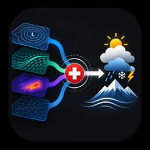

<p align="center">
  
</p>

# SwissWeather Fusion

A Home Assistant integration that fuses multiple weather forecast sources —
MeteoSwiss's ICON-CH1-EPS and ICON-CH2-EPS, DWD's ICON-D2, SRF (SRG SSR),
and meteoblue — into a single locally-corrected forecast, continuously
learning the bias between each source and your own weather station. It
also runs a short-horizon storm-onset indicator for summer convective
weather (temperature/rain arriving together with a pressure signature),
using MeteoSwiss's CombiPrecip radar feed and an optional independent
check from Meteonomiqs.

**Status: v0.3.5 — the reference station now also publishes every 10-minute record of the last 6 hours (`recent_values`). v0.3.4 — for downstream consumers: cloud cover by layer (low / mid / high), corrected SRF irradiance timing, and live measurements from the nearest MeteoSwiss station; on top of v0.3.3 solar radiation and the v0.3.x measurement release.** 913 tests, package pyflakes clean.

> **If you have ever seen "Config flow could not be loaded: 500 Internal
> Server Error"** when opening setup, reconfigure or Configure — that was
> real, and it affected every version from v0.1.24 to v0.3.1. Fixed in
> v0.3.2.

This version adds **no forecasting capability at all**. It exists to make
one question answerable: *does blending five sources actually beat simply
using the best one?*

Until now the integration reported an answer to that question, and the
answer could not be trusted. `blend_beats_best_source` compared two
averages drawn from different sets of forecasts — the blend was scored
only at lead times up to 48 hours, each provider across its whole
horizon — so the blend was being graded on an easier exam. It could read
`true` while the forecast on your dashboard was worse than just using
ICON-CH1. That attribute is gone, replaced by a paired comparison that
scores the blend and every source on identical target hours.

The honest position: **nobody knows yet whether the fusion in this
integration earns its complexity.** v0.3.0 is the instrument, not the
finding. Expect to run it for two to three months before the numbers mean
anything. If the answer comes back "no", that is a useful result and the
project should act on it.

v0.3.1 additionally remediates an external adversarial ICS audit: 76
findings triaged to ~47 distinct issues, 19 confirmed, 8 declined with
reasons — including two whose proposed fix would have introduced a worse
defect. Three of the confirmed findings were defects v0.3.0 itself
introduced. Full account in
[swissweather_fusion_v0.3.1_release_audit.md](swissweather_fusion_v0.3.1_release_audit.md).

Earlier history: v0.1.24–v0.2.8 closed 62 defects found across two
external audits and one independent audit — see
[swissweather_fusion_v0.2.8_release_audit.md](swissweather_fusion_v0.2.8_release_audit.md),
including the five places the external audits were themselves wrong.
v0.3.0's own account is in
[swissweather_fusion_v0.3.0_release_audit.md](swissweather_fusion_v0.3.0_release_audit.md).

Continued real-world testing remains the priority. This is a
carefully-reviewed codebase, not a battle-tested one.

> **Upgrading to v0.3.5?** No database migration and no learning reset —
> nothing changes except one new attribute, `recent_values`, on
> `sensor.swissweather_fusion_reference_station`, filled at the first
> update after the restart (see
> [swissweather_fusion_v0.3.5_release_audit.md](swissweather_fusion_v0.3.5_release_audit.md)
> and "Reference station" below).
>
> **Upgrading to v0.3.4?** No database migration and no learning reset —
> the running accuracy trial is untouched (see
> [swissweather_fusion_v0.3.4_release_audit.md](swissweather_fusion_v0.3.4_release_audit.md)).
> The cloud layers appear in the hourly forecast with the **next new model
> run** after the upgrade (within about 3 hours for ICON-CH1/ICON-D2, 6
> hours for ICON-CH2), for the same reason as radiation in v0.3.3.
>
> **New in v0.3.4 — reference station.** Measured 10-minute data from the
> nearest MeteoSwiss station that measures solar radiation (Tänikon for a
> Frauenfeld location) appear within 10 minutes of the upgrade: eleven new
> sensors plus the usual four health sensors for the new source, see
> "Reference station" below. Observation only — it does not
> touch the learning.
>
> **Changed in v0.3.4 — SRF irradiance is one hour earlier than in
> v0.3.3**, now correctly: its series is keyed by `period_start` /
> `period_end` like the solar series (the `time` key is gone). If
> anything reads `sensor.swissweather_fusion_srf_global_irradiance`'s
> `hourly_forecast`, read `period_start` / `period_end` instead of `time`,
> and remove any one-hour shift you applied yourself: the series is now
> aligned, and shifting again would make it an hour early.
>
> **Upgrading to v0.3.3?** No database migration and no learning reset —
> the running accuracy trial is untouched (see
> [swissweather_fusion_v0.3.3_release_audit.md](swissweather_fusion_v0.3.3_release_audit.md),
> §3). Solar radiation appears with the **next new model run** after the
> upgrade, not immediately: within about 3 hours for ICON-CH1/ICON-D2 and 6
> hours for ICON-CH2. That delay is deliberate — it is what keeps the
> upgrade from re-storing the current run and double-counting it in the
> learning.
>
> Also in v0.3.3: the four `wetteralarm_*` health sensors (last success,
> last poll duration, last data error, consecutive failures) now show
> real values. Since v0.2.6 they could only read `unknown` / `0`, even
> though Wetter-Alarm itself was polling correctly.
>
> **Upgrading to v0.3.2?** No database migration and no learning reset —
> v0.3.2 is a display and forms fix. Learned statistics are preserved.
>
> **Upgrading to v0.3.1 from v0.3.0?** This release migrates to schema
> v5 and **clears learned bias statistics again**, ten days after v0.3.0
> did. That is not a mistake: v0.3.1 fixes a defect live since v0.1 in
> which forecast rows for hours that had *already passed* were stored and
> graded as short-range forecasts. Roughly a quarter of every Open-Meteo
> poll was teaching the model that its forecast skill equalled its
> hindsight. Every bucket learned before now is optimistic, so it goes.
>
> Preserved: forward forecast history, station observations, radar and
> storm history. **Expect a visible accuracy dip for several days — that
> is the reset, not a fault.** The evaluation window starts from this
> deploy.
>
> **Upgrading from before v0.3.0?** The schema v4 migration also applies:
> learned statistics are cleared and run-time attribution columns added.
>
> **Upgrading from before v0.2.8?** The v3 rebuild also applies: radar
> observations and storm predictions are discarded, and you will be
> asked once whether your pressure sensor reports sea-level or
> station-level pressure — see below.


## Which pressure sensor to choose

This matters more than it looks. Netatmo — and several other stations —
publish **two** pressure values:

| Entity | What it is |
| --- | --- |
| `sensor.<station>_pressure` | Normalised to **mean sea level** using the altitude captured during setup |
| `sensor.<station>_absolute_pressure` | The **raw** pressure measured at your station's altitude |

Home Assistant gives both the same `atmospheric_pressure` device class,
so the integration cannot tell them apart — you have to say which one you
picked. During setup there is a checkbox, **"My pressure sensor already
reports sea-level pressure"**:

- Using **absolute pressure**? Leave it **off** (the default). The
  integration reduces the reading to sea level itself.
- Using the normalised **pressure** entity? Turn it **on**.

Getting this wrong introduces a constant error of roughly 60 hPa at 500 m
altitude, which Model A would otherwise faithfully learn as forecast
"bias". You can change the answer later under **Configure**.

## What this does

- **Model A** — blends CH1, CH2, ICON-D2, SRF, and meteoblue's forecasts,
  each corrected for its own systematic bias against your specific
  location, learned continuously and automatically (no manual tuning).
- **Model B** — watches your station's pressure/humidity/temperature trend
  plus a live radar precipitation reading (at your location and three
  points upwind, roughly 20/35/60 minutes out) for the classic summer
  storm signature, and exposes a live "storm probability" percentage —
  useful for automations like closing blinds ahead of a downpour.

This is **not** a replacement for professional weather models — it can't
run atmospheric physics. It corrects and blends forecasts that already
exist, the same way national weather services localize their own
forecasts (a technique called Model Output Statistics).

## Requirements

- A Home Assistant instance with local temperature, humidity, and pressure
  sensors already set up (rain/wind support is planned for later).
- Four free API credentials (no cost for the tiers this integration uses):
  - **SRF (SRG SSR)**: register at [developer.srgssr.ch](https://developer.srgssr.ch),
    create an App on the "SRG SSR PUBLIC API V2" product, get a consumer
    key/secret.
  - **meteoblue**: register for the free Weather API at
    [meteoblue.com](https://www.meteoblue.com).
  - **Meteonomiqs (wetter.com)**: contact `info@meteonomiqs.com` for an API
    key.
  - MeteoSwiss's own CH1/CH2 data and DWD's ICON-D2 are fetched via
    [Open-Meteo](https://open-meteo.com), which needs no account or key.
    An Open-Meteo API key is optional — only relevant if you're on their
    paid/commercial tier (higher rate limits and dedicated
    infrastructure; it does not make CH1/CH2/D2 refresh more often, since
    that's fixed by MeteoSwiss/DWD's own model schedule). Leave it blank
    for the free tier.

## Installation

1. Add this repository as a custom repository in HACS, or copy
   `custom_components/swissweather_fusion` into your `config/custom_components/` folder.
2. Restart Home Assistant.
3. Go to **Settings → Devices & Services → Add Integration**, search for
   "SwissWeather Fusion".
4. Follow the setup steps: location & elevation, local station sensors,
   then the four API credentials.

### About the icon

`icons/icon.png` (256×256) and `icons/icon@2x.png` (512×512) are included,
sized to match the [home-assistant/brands](https://github.com/home-assistant/brands)
convention. Worth being upfront about a real limitation here: for a
private/custom HACS repository (added manually, not the default HACS
store), there isn't a way to make this icon show natively next to the
integration in HA's own Settings → Devices & Services list or HACS's
store UI — that specific placement is sourced from the `brands` repository,
which requires submitting a PR there and is really only appropriate once
this is a public, stable, more broadly-used integration. Until then, the
icon displays wherever this repo's README is rendered (HACS's own repo
info page, GitHub itself), which is what's set up above.

## Configuration notes

- **Location**: use precise coordinates, not a postal code — this
  integration exists to correct for microclimate variation, and a postal
  code covers an area wider than that variation.
- **Elevation**: auto-looked-up from your coordinates by default; enter a
  manual value if you have a more precise one (e.g. from a differential
  GPS survey) — this feeds an optional physics-based correction that gives
  Model A a head start before it's learned anything from data yet.
- Everything is editable later via the integration's **Configure** button,
  not just at initial setup.

## Sensors

Beyond the main `weather.*` entity, this integration exposes:

- `sensor.*_status`, `*_forecast_accuracy`, `*_active_sources`
- `sensor.*_last_learning_a` / `*_last_learning_b` — when each model last
  updated its correction
- `sensor.*_expert_weight_<source>` — one per blend source, for seeing how
  much each is currently trusted
- `sensor.*_storm_onset_probability` — the live storm indicator
- Per-source health: `*_last_success`, `*_last_poll_duration`,
  `*_last_data_error`, `*_consecutive_failures`, and `*_last_auth_error`
  for SRF specifically
- `binary_sensor.*_degraded` — one glance-able "is anything unhealthy" flag
- `sensor.*_blend_comparison` — **new in v0.3.0**, and the one to watch.
  Its state is how many (measurement, lead-time) cells the blend
  currently wins. Attributes carry the verdict, the sample count behind
  it, and a per-cell table.

### Solar radiation (new in v0.3.3)

Location-level radiation for downstream consumers. **No panel
geometry is applied here**: the consumer owns tilt and azimuth and
computes tilted irradiance (GTI) itself, so adding or changing an array
never touches this integration.

| Entity (default ID) | Meaning |
|---|---|
| `sensor.swissweather_fusion_solar_irradiance_ghi_hour_average` | Global horizontal irradiance, average over the current hour. **Carries the full hourly series** in its `hourly_forecast` attribute. |
| `sensor.swissweather_fusion_solar_irradiance_dni_hour_average` | Direct normal irradiance, current-hour average |
| `sensor.swissweather_fusion_solar_irradiance_dhi_hour_average` | Diffuse horizontal irradiance, current-hour average |
| `sensor.swissweather_fusion_solar_irradiance_{ghi,dni,dhi}_instant` | The same three, instantaneous at the start of the current hour |
| `sensor.swissweather_fusion_srf_global_irradiance` | SRF's own global irradiance, separate and unfused |
| `sensor.swissweather_fusion_snow_depth` | Fused snow depth on the ground (m) |

How to read the `hourly_forecast` series:

- One entry per hour, keyed by `period_start` / `period_end` (UTC).
  `ghi`, `dni`, `dhi` are **averages over that hour**; `ghi_instant`,
  `dni_instant`, `dhi_instant` are values **at `period_start`**. Open-Meteo
  itself labels averages at the *end* of the hour; this series has already
  converted that, so do not shift it again.
- Values are W/m², hourly only. ICON-CH1/CH2 publish hourly; finer steps
  would be interpolation, which this integration does not do.
- Fused as a **mean over the models that supply a complete GHI/DNI/DHI
  triple from one model run** (`sources` says how many — 3 near-term,
  falling to 1 beyond ~48 h). That keeps GHI = DHI + DNI·cos(zenith)
  intact, so any transposition model can use the triple directly.
- **Not bias-corrected.** Nothing learns radiation; that would need measured
  radiation as ground truth.
- The series attribute is excluded from the recorder (it would otherwise
  be stored again on every update). Read it live; do not expect history.

SRF's irradiance is exposed separately because it is the only radiation
source outside the ICON model family, and because SRF supplies one value
with no direct/diffuse split — mixing it into the triple would break the
identity above. SRF documents it only as "Global irradiance in W/m²"; the
labelling at the end of the interval was established by measurement
(v0.3.4, see below). Its series uses the same `period_start` /
`period_end` keys as the solar series: 1-hour periods in SRF's hourly
window, 3-hour periods beyond it.

### Cloud cover by layer (new in v0.3.4)

Every entry of the weather entity's hourly forecast now carries, next to
the standard `cloud_coverage`:

| Field | Meaning |
|---|---|
| `cloud_coverage_low` | low cloud, surface to ~2 km — includes fog and stratus |
| `cloud_coverage_mid` | mid-level cloud, ~2–6 km |
| `cloud_coverage_high` | high cloud, above ~6 km (cirrus) |

Read them with the standard service:

```yaml
action: weather.get_forecasts
target:
  entity_id: weather.swissweather_fusion_<entry_id>_weather
data:
  type: hourly
```

- Percent, valid **at** the hour shown (like `cloud_coverage`), mean of the
  ICON models that supply them (CH1, CH2, D2). meteoblue's basic package
  and SRF have no layer split.
- The three layers do **not** add up to the total: seen from the ground,
  layers overlap. 60 % low and 60 % high can be 70 % total.
- A field is **absent** when no model has a value for that hour (beyond
  ICON's ~5-day horizon), never `0` — a 0 % low layer that nobody forecast
  would read as "no fog".
- Hourly forecast only. Not part of Home Assistant's standard forecast
  fields, so weather cards ignore them; they are for automations and other
  consumers. The daily and twice-daily forecasts are unchanged.
- Not bias-corrected and not verified: there is no local measurement of
  cloud layers. Low cloud and fog are where weather models are weakest —
  treat a high `cloud_coverage_low` as a warning sign for the solar
  forecast, not as a measurement.

**SRF irradiance timing (fixed in v0.3.4).** Compared with the Tänikon
pyranometer (6–11 Oct 2026), SRF labels its global irradiance at the **end**
of the interval: SRF's 14:00 value describes 13:00–14:00. v0.3.3 passed the
label through, so the sensor showed each hour's value one hour late (hourly
error 98 W/m²; 66 W/m² when read correctly). v0.3.4 keys the series by
period like the solar series; the sensor's state is the value for the
current hour.

### Reference station (new in v0.3.4)

Live measurements from a MeteoSwiss SwissMetNet station, refreshed every 10
minutes (MeteoSwiss publishes about 10–20 minutes after the measurement).

**Which station.** By default the nearest station within 50 km that
measures global radiation (many SwissMetNet sites only measure rain). For a
Frauenfeld location that is Tänikon (TAE, ~8 km). To choose another one,
enter its three-letter code under **Configure → MeteoSwiss reference
station**; leave it blank for automatic.

| Entity (default ID) | Meaning |
|---|---|
| `sensor.swissweather_fusion_reference_station` | Time of the newest record. **Attributes carry the complete dataset**: `values` (every parameter by MeteoSwiss short name), `parameters` (English description and unit of each), `station` (code, name, coordinates, distance), `age_minutes`, `stale`, and since v0.3.5 `recent_values` (every record of the last 6 hours, below) |
| `sensor.swissweather_fusion_reference_station_temperature` | Air temperature 2 m (°C) |
| `…_humidity` | Relative humidity (%) |
| `…_pressure_sea_level` | Pressure reduced to sea level, QFF (hPa) |
| `…_global_radiation` | Global radiation, 10-minute mean (W/m²) |
| `…_sunshine_10_min` | Sunshine in the last 10 minutes (min) |
| `…_longwave_radiation_from_the_sky` | Incoming longwave radiation (W/m²) — high values with little sun mean a cloud deck |
| `…_wind_speed`, `…_wind_gust`, `…_wind_direction` | 10-minute wind (m/s, °) |
| `…_precipitation_10_min` | Precipitation in the last 10 minutes (mm) |

- Times are UTC. 10-minute means and sums cover the 10 minutes **ending**
  at the record time; instantaneous values are taken at it.
- The value sensors read **unknown** when the newest record is more than
  60 minutes old — an old reading is not shown as current.
- Everything else the station reports (e.g. at Tänikon: diffuse radiation,
  reflected shortwave, longwave out, snow depth, soil temperatures, station
  and QNH pressure) is in the dataset sensor's `values`. Those attributes
  are not stored in the recorder; the eleven sensors have history.
- **`recent_values` (v0.3.5).** Every 10-minute record of the last 6
  hours, oldest first: `[{"time": "2026-10-13T05:10:00+00:00", "values":
  {...}}, ...]` — up to 36 records, same parameter names as `values`,
  `time` = end of the interval. MeteoSwiss publishes with a varying 10–20
  minute delay, so a 10-minute poll does not see every record as the
  newest one; this list is read from MeteoSwiss's file (which holds every
  record since yesterday 12 UTC) on every poll, so none is skipped and it
  is complete again right after a restart. A record MeteoSwiss has not
  published is absent, never filled in. Not stored in the recorder.
- **Observation only.** The station never enters the learning or the
  blend; your own station remains the reference of the accuracy trial.
- Source: MeteoSwiss open government data.

### Reading the blend comparison

The state is a count rather than a yes/no because a count degrades
honestly: `0` with `cells_with_verdict: 0` means *not enough data yet*,
while `0` with `cells_with_verdict: 12` means *the blend is losing*. A
boolean cannot tell you which of those you are looking at.

Expect `verdict: null` for the first weeks. Each cell needs at least 30
scored pairs, and a 48-hour-lead cell cannot record its first pair until
48 hours after the forecast was made.

The per-cell table is the interesting part. "The blend wins at 1 hour and
loses at 48" is an actionable result — it would mean restricting the
blend to short horizons — and a single overall verdict would hide it.

`blend_accuracy` and `best_source_accuracy` both remain, but **do not
chart them against each other.** They are measured over different sets of
forecasts and the comparison flatters the blend. Both sensors now say so
in their attributes.

## Known v0.1 limitations

- `forecast_accuracy` and `last_learning_b` are honest stubs (return
  `None`) — `forecast_accuracy` pending a real rolling-MAE implementation,
  `last_learning_b` because Model B's v1 trained classifier genuinely
  doesn't exist yet (see DEVELOPER.md for the v0→v1 upgrade path).
  `last_learning_a` is no longer a stub — Model A's actual bias-learning
  step (comparing past forecasts against real station readings and
  updating the learned correction) now runs every 20 minutes; this sensor
  reports its last real run.
- The CombiPrecip radar client's HDF5 parsing is built against the
  documented ODIM_H5 standard, not a downloaded real file (no network
  access to data.geo.admin.ch in the environment that built this) — worth
  verifying against a real file early.
- Model B's v0 rule is a hand-crafted heuristic, not a trained model — see
  DEVELOPER.md for the upgrade path once a storm season of data exists.

## Diagnostics

Per-source health is real, not a placeholder: each of the 5 vendor
integrations (Open-Meteo, tracked per-model since CH1/CH2/D2 can fail
independently; SRF; meteoblue; CombiPrecip; Meteonomiqs) exposes its own
last-success time, last poll duration, consecutive-failure count, and —
critically — **data errors and auth errors as separate sensors**. An
expired or revoked credential (SRF is the one source with a true
credential that can expire) shows up specifically as
`sensor.*_srf_last_auth_error`, distinct from a generic timeout, since the
fix is different (re-enter credentials vs. just wait for the normal
retry). `binary_sensor.*_degraded` gives one glance-able "is anything
wrong" flag; the per-source sensors tell you which one and why.

### Detailed diagnostic logging (off by default)

For deeper troubleshooting than the per-source sensors give you, this
integration has a toggleable, downloadable diagnostic log:

1. **Settings → Devices & Services → SwissWeather Fusion → Configure**,
   enable "Enable detailed diagnostic logging." This reloads the
   integration and starts capturing detailed events (poll attempts,
   successes, failures, and — for SRF specifically — the full raw API
   response body) into memory.
2. Let the problem you're investigating actually happen.
3. **Settings → Devices & Services → SwissWeather Fusion → ⋮ (three-dot
   menu) → Download Diagnostics.** This uses Home Assistant's own
   built-in diagnostics mechanism — no custom download tool, just the
   standard one every integration can use.
4. Turn the toggle back off once you're done, if you don't want it
   running continuously.

Two things worth knowing about this file before you share it:
- **Credentials, coordinates, and elevation are redacted automatically**,
  including inside raw third-party API response bodies (not just this
  integration's own configuration) — location data can be embedded in a
  third-party response in fields this project doesn't fully control the
  shape of, so redaction is deliberately broad rather than a fixed list
  of known keys.
- **The buffer is in-memory only** — it resets on restart or reload
  (including when you toggle the setting itself, since that reloads the
  integration). It's meant for "enable it, reproduce the problem, download
  it" in one sitting, not a historical log you can look back at days
  later.

## More detail

See [DEVELOPER.md](DEVELOPER.md) for the full architecture rationale —
why two models instead of one, why EMA instead of gradient boosting, why
each source was included or rejected, and what's actually been verified
versus what's a documented best guess.
